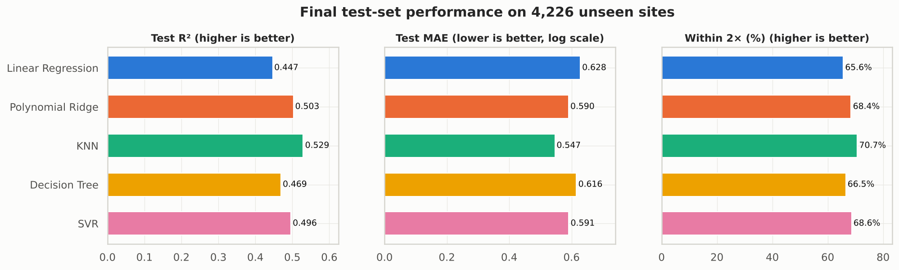
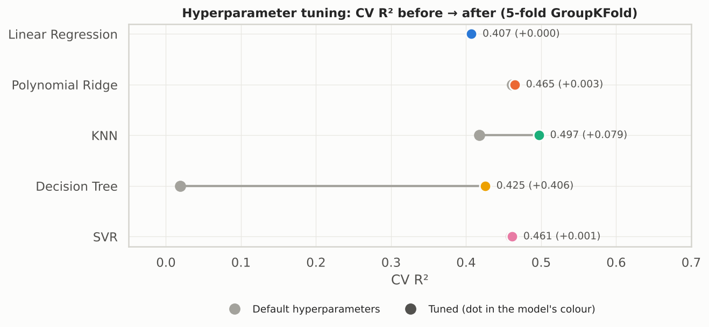
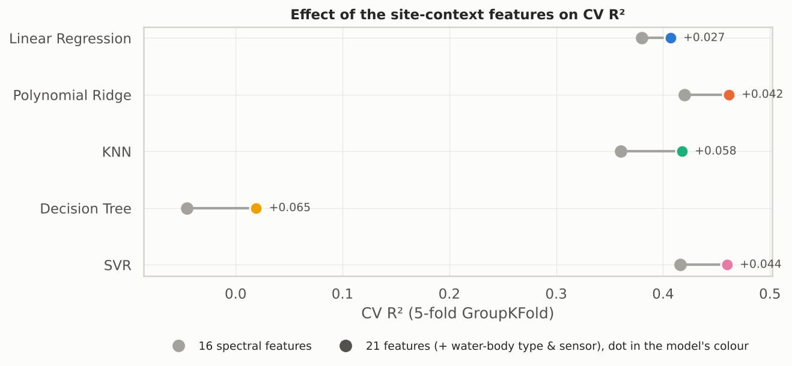
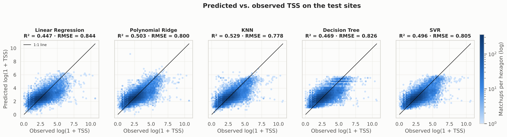
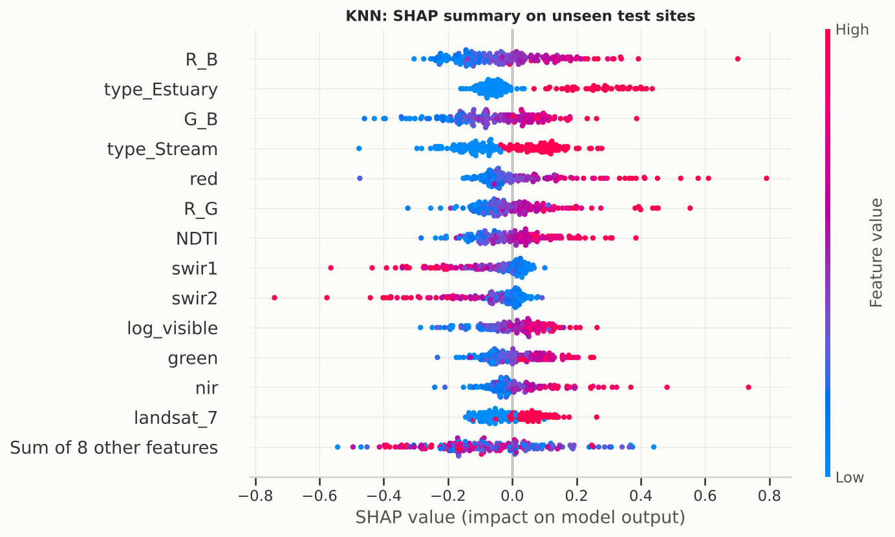
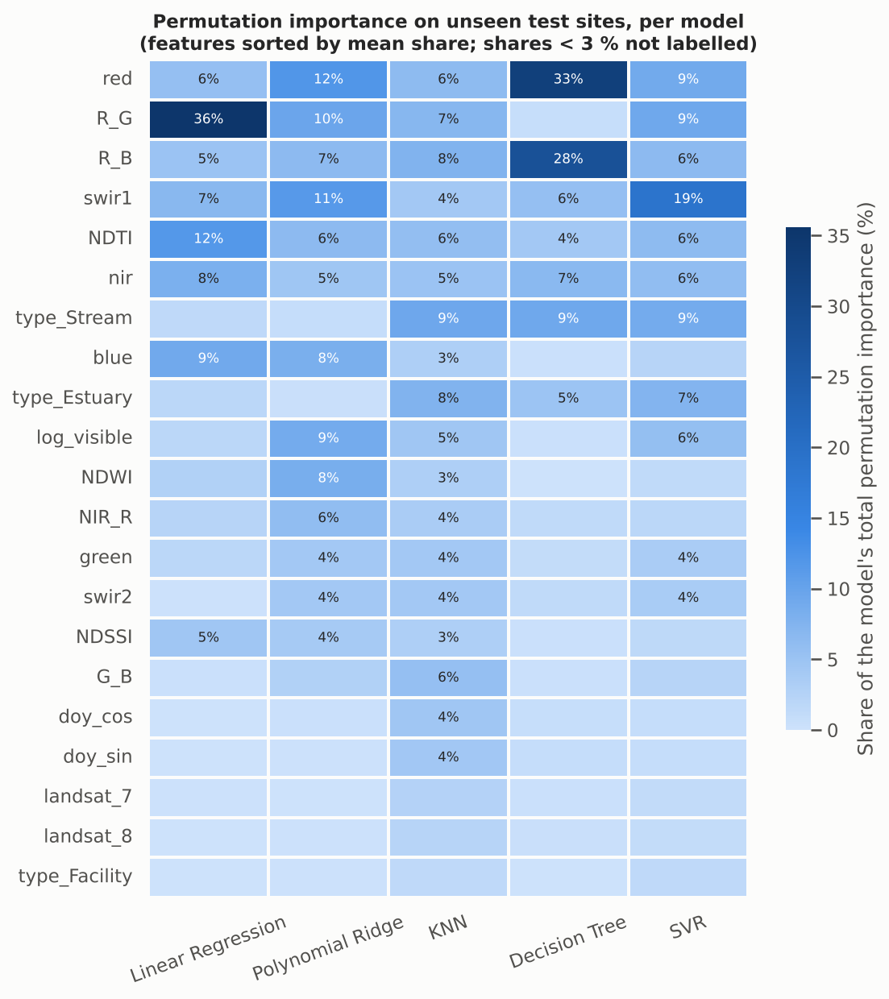

# Predicting Water Turbidity (TSS) from Landsat Imagery — Five-Model Comparison

**2107541 Machine Learning for Environmental Applications** · Project 2: Environmental Machine Learning Project · AY2026 Semester 1
Chulalongkorn University, Faculty of Engineering

**Contributor:** Chatrphol Ovanonchai (6730084521)

> **Branch `5-Model-Assignment`.** This branch follows the Project 2 brief: at least 5 models, hyperparameter tuning,
> explainable ML, and a fixed repository layout. It reuses the problem, dataset, cleaning rules and spectral features of the
> ensemble-learning version on [`main`](https://github.com/NuBFightForMyDream/2107541_MLEnvi_Project_PredictingWaterTurbidityWithTSS/tree/main)
> (Random Forest / XGBoost / MLP + web visualizer), and compares **five basic supervised learning models** instead.

**Notebook:** [`notebooks/ML_analysis.ipynb`](notebooks/ML_analysis.ipynb) (runs top to bottom with saved outputs) · **Figures:** [`figures/`](figures/)

---

## Environmental problem

Turbidity, measured here as **Total Suspended Solids (TSS, mg/L)**, is a core indicator of surface water quality. High TSS
comes from soil erosion, agricultural and urban runoff, construction and the resuspension of bottom sediment. It blocks
light for aquatic plants, clogs fish gills, carries attached nutrients, metals and pathogens, and raises drinking-water
treatment costs. Field sampling is accurate but expensive, so most rivers, lakes and estuaries are sampled rarely or never.

Landsat images almost every water body every 8–16 days, with an archive back to 1984. Suspended particles change the colour
of water (more red and near-infrared light is scattered back), so **if TSS can be predicted from satellite reflectance,
water quality can be monitored far beyond the sites that are sampled in the field.**

## Dataset source

[**AquaSat**](https://figshare.com/articles/dataset/AquaSat/8139383) — Ross et al. (2019), *Water Resources Research*,
[doi:10.1029/2019WR024883](https://doi.org/10.1029/2019WR024883), CC BY 4.0. AquaSat pairs in-situ water quality samples
(US Water Quality Portal, LAGOS-NE) with Landsat 5/7/8 surface reflectance taken over the same site within about ±1 day.

| | |
|---|---|
| Raw matchups | 603,432 |
| After cleaning | **128,603** matchups from **21,129** sites (1984–2019) |
| Site types (after cleaning) | Stream 48.7 % · Estuary 27.0 % · Lake 23.5 % · Facility 0.8 % |
| Stored as | [`data/aquasat.csv.gz`](data/aquasat.csv.gz) (74 MB gzip of the 291 MB original; see [`data/README.md`](data/README.md)) |

> Note: despite the "lake" framing on `main`, the cleaned data are mostly **streams and estuaries**. This branch treats
> water-body type as an explicit feature and reports results per type.

## Research questions

1. **RQ1** — Can Landsat surface reflectance predict TSS at water sites that were *never* used for training, and how accurately?
2. **RQ2** — Which of five basic supervised learning models performs best, and how much do non-linearity and hyperparameter tuning help over a linear baseline?
3. **RQ3** — Does adding simple site context (water-body type, Landsat sensor) to the spectral features improve the prediction?
4. **RQ4** — Which features drive the predictions, and are they consistent with the optics of suspended sediment?
5. **RQ5** — Where does the model fail (by TSS level and water-body type), and what does that mean for monitoring?

## Methods

The notebook follows the nine steps of the assignment brief.

**1–2. Dataset and problem.** Supervised regression. Target = `log(1 + TSS)` because TSS is extremely right-skewed
(median 11 mg/L, max 73,900 mg/L; skewness 129 → 0.83 after the log).

**3. Data preparation** (same rules as `main`):
1. keep rows with TSS > 0 mg/L;
2. keep valid surface reflectance (every band in (0, 10000]);
3. keep clear-water pixels only (Landsat QA = 68 for Landsat 5/7, 324 for Landsat 8);
4. keep pixel windows that are mostly water (`pwater` ≥ 50 %).

**Outlier handling (new).** Band ratios explode when red or blue reflectance is close to zero (e.g. `R_B` max = 41.5 while
its 99.9th percentile is 2.6). Every pipeline therefore starts with a `QuantileClipper` that clips each continuous feature to
its 0.1–99.9th percentile range **learned on the training fold only**. Without it, the polynomial model predicted values of
−300 for a handful of dark pixels and one cross-validation fold scored R² = −4.7.

**4. Feature engineering — 21 features.**

| Group | Features |
|---|---|
| Landsat bands (×10⁻⁴ → reflectance) | `blue`, `green`, `red`, `nir`, `swir1`, `swir2` |
| Turbidity / water indices | `NDTI` = (R−G)/(R+G), `NDWI` = (G−NIR)/(G+NIR), `NDSSI` = (B−NIR)/(B+NIR) |
| Band ratios, brightness | `R_G`, `R_B`, `G_B`, `NIR_R`, `log_visible` = log(B+G+R) |
| Season | `doy_sin`, `doy_cos` (cyclical day of year) |
| **Site context (new)** | `type_Stream`, `type_Estuary`, `type_Facility` (ref. Lake); `landsat_7`, `landsat_8` (ref. Landsat 5) |

**5. Five models** (scikit-learn pipelines; scaling and clipping fitted inside each fold):

| # | Model | Lecture |
|---|---|---|
| 1 | Multiple Linear Regression (baseline) | 5 |
| 2 | Polynomial Ridge Regression (polynomial features + L2) | 6 |
| 3 | K-Nearest Neighbors Regression | 4 |
| 4 | Decision Tree Regression | 2 |
| 5 | Support Vector Regression, RBF kernel (fitted on a 15,000-row random subsample per fit, because kernel SVR scales ~O(n²)) | 3 |

**Validation without data leakage.** The same site appears many times, so every split is grouped by `SiteID`:
- train/test: `GroupShuffleSplit`, 80 % / 20 % of the **sites** (102,142 / 26,461 matchups; 16,903 / 4,226 sites, zero overlap);
- model comparison: 5-fold `GroupKFold` on the training sites;
- tuning: `GridSearchCV` with 3-fold `GroupKFold`;
- the test set is used **once**, for the final tuned models.

**6. Hyperparameter tuning** (`GridSearchCV`, scoring = R²):

| Model | Grid |
|---|---|
| Polynomial Ridge | `degree` ∈ {1, 2, 3} × `alpha` ∈ {0.1, 1, 10, 100} |
| KNN | `n_neighbors` ∈ {5, 10, 20, 30, 50, 80} × `weights` ∈ {uniform, distance} |
| Decision Tree | `max_depth` ∈ {4, 6, 8, 10, 12, 15, 20, None} × `min_samples_leaf` ∈ {1, 10, 30, 100} |
| SVR | `C` ∈ {1, 3, 10} × `gamma` ∈ {scale, 0.1} × `epsilon` ∈ {0.1, 0.3} |

**7. Evaluation metrics.** R², RMSE and MAE on `log(1 + TSS)`; bias; **% of predictions within a factor of 2** of the
measured TSS; **typical error factor** = exp(median |log error|); accuracy of three illustrative turbidity classes
(Low < 10, Moderate 10–50, High ≥ 50 mg/L).

**8. Explainable ML.** Permutation importance on the test sites for all five models; SHAP (permutation explainer) for the
best model; the top split rules of the decision tree; standardized linear-regression coefficients.

**9. Environmental interpretation.** See the section below and Section 9 of the notebook.

## Main results

All scores are on `log(1 + TSS)` for **sites never seen during training**. CV = 5-fold `GroupKFold` on the training sites;
Test = the held-out 4,226 sites (26,461 matchups), used once.

| Model | CV R² (default) | CV R² (tuned) | **Test R²** | Test RMSE | Test MAE | Within 2× | Typical error |
|---|---|---|---|---|---|---|---|
| Linear Regression | 0.407 | 0.407 | 0.447 | 0.844 | 0.628 | 65.6 % | 1.62× |
| Polynomial Ridge | 0.461 | 0.465 | 0.503 | 0.800 | 0.590 | 68.4 % | 1.57× |
| **KNN** | 0.418 | **0.497** | **0.529** | **0.778** | **0.547** | **70.7 %** | **1.50×** |
| Decision Tree | 0.019 | 0.425 | 0.469 | 0.826 | 0.616 | 66.5 % | 1.61× |
| SVR (RBF) | 0.460 | 0.461 | 0.496 | 0.805 | 0.591 | 68.6 % | 1.57× |

*Within 2×* = share of predictions between half and double the measured TSS. *Typical error* = exp(median |log error|).



**Key findings**

- **Non-linear models beat the linear baseline** (test R² 0.447 → 0.47–0.53), so the reflectance–TSS relationship is non-linear.
- **Tuning decides whether over-fitting models are usable.** The default Decision Tree memorises the training sites
  (train R² 0.993, CV R² 0.019); `max_depth=12`, `min_samples_leaf=100` lifts its CV R² to 0.425. KNN improves from 0.418 to 0.497
  with k = 30 and distance weights. Polynomial Ridge and SVR gain < 0.005.
- **Feature engineering helps every model** (RQ3): adding water-body type and Landsat sensor raises CV R² by +0.027 to +0.065.
- **Outlier clipping is essential for the polynomial model**: without it one CV fold collapsed to R² = −4.7.
- **All models compress the range**: clear water is over-predicted and very turbid water (hundreds to thousands of mg/L) strongly under-predicted.
- By water-body type (best model): streams R² 0.563, lakes 0.440, estuaries 0.287 (narrow TSS range; lowest MAE 0.511), facility sites ≈ 0 (281 samples).
- Turbidity classes (Low < 10, Moderate 10–50, High ≥ 50 mg/L): **69.4 % accuracy** vs. 44.7 % for always guessing "Moderate".
  Only 0.5 % of clear samples are called "High", and only 6.8 % of highly turbid samples are called "Low".

<p align="center">
  
  
</p>



## Best model

**K-Nearest Neighbors Regression** — `QuantileClipper → StandardScaler → KNeighborsRegressor(n_neighbors=30, weights="distance")`

- Selected by cross-validation **before** the test set was used: CV R² = 0.497 ± 0.025 (next best: Polynomial Ridge 0.465).
- Test set: **R² = 0.529**, RMSE = 0.778, MAE = 0.547 (log scale); typical error ≈ 1.5×; 70.7 % of predictions within 2×.
- Why it wins: it predicts TSS from the most spectrally similar samples *of the same kind of water body*, which captures
  non-linear, setting-specific relationships without assuming a functional form. Averaging 30 neighbours smooths the noise of
  field samples.
- For context, the tuned Random Forest on `main` reached test R² = 0.503 on the same test sites with 16 features. The gain here
  comes mainly from the new context features and clipping, not from KNN being a stronger algorithm.

## Feature importance

Permutation importance (all five models, test sites) and SHAP (best model):

| Rank | KNN — permutation importance (drop in test R²) | KNN — mean \|SHAP\| |
|---|---|---|
| 1 | `type_Stream` 0.096 | `R_B` 0.120 |
| 2 | `type_Estuary` 0.078 | `type_Estuary` 0.118 |
| 3 | `R_B` 0.078 | `G_B` 0.114 |
| 4 | `R_G` 0.072 | `type_Stream` 0.111 |
| 5 | `red` 0.065 | `red` 0.096 |
| 6 | `NDTI` 0.060 | `R_G` 0.088 |
| 7 | `G_B` 0.058 | `NDTI` 0.081 |

- Both methods agree on the same top-7 features: **red-band information** (`red`, `R_B`, `R_G`, `NDTI`, `G_B`) and **water-body type**.
- Red-band features are also at the top for the other four models; the decision tree's first split is `R_B ≤ 1.22`.
- SHAP directions: higher `R_B`, `red`, `R_G`, `NDTI` → higher TSS; stream or estuary → higher TSS; higher `swir1`/`swir2` → **lower** TSS.
- Permutation importances of the linear and polynomial models are inflated, because near-duplicate features (`NDTI` is an exact
  transform of `R_G`) get large opposite-sign coefficients. The heatmap therefore shows each model's *share* of importance.

<p align="center">
  
  
</p>

## Environmental interpretation

- **Consistent with water optics.** Clear water reflects mostly blue/green light; suspended particles scatter light back, especially
  in the red (and NIR at high loads), so turbid water looks brighter and redder. The features every model relies on — the red band,
  red/blue and red/green ratios, NDTI — measure exactly this shift.
- **The setting matters as much as the colour.** Streams carry erosion and runoff sediment, estuaries are stirred by tides, and lakes
  let particles settle. Algae, dissolved organic matter and shallow bottoms also change water colour without adding sediment. That is why
  water-body type is a top predictor.
- **SWIR as a correction.** Water absorbs almost all SWIR light, so a strong SWIR signal over water usually comes from glint, haze or
  nearby land. The negative SWIR effect suggests the model learned to discount visible brightness that is not caused by sediment.
- **What the accuracy allows.** A typical error of ≈ 1.5× and 71 % of predictions within 2× is good enough to **screen and rank**
  thousands of unsampled water bodies, **target field sampling**, and build **long-term turbidity trends** from the Landsat archive.
  It is **not** good enough to replace field measurements for regulatory compliance.
- **The weakest point is the most important one.** Storm runoff, flood and dredging plumes (hundreds to thousands of mg/L) are strongly
  under-predicted: they are rare in the training data (12 % of samples ≥ 50 mg/L), visible reflectance saturates at high sediment loads,
  and TSS changes within hours while the image may be a day away from the field sample.

**Room for improvement:** add watershed land use, slope, rainfall/streamflow before the image and lake depth; keep only same-day
matchups; validate with spatial blocks (whole watersheds) instead of single sites; weight or model the rare high-TSS events separately;
use a kernel approximation so SVR can use all 100 k rows; and combine the new context features with the ensembles from `main`.

## Repository structure

```
├── README.md
├── requirements.txt
├── data/
│   ├── aquasat.csv.gz                    # AquaSat matchups (gzip, 74 MB)
│   ├── aquasat_column_dictionary.pdf
│   └── README.md                         # source, license, checksums
├── notebooks/
│   └── ML_analysis.ipynb                 # full workflow, executed with outputs
├── figures/                              # 18 figures saved by the notebook
└── Resources/                            # assignment brief, background paper, AI reference example
```

| Figure | Content |
|---|---|
| `01`–`03` | TSS distribution, site map, TSS by water-body type |
| `04`–`05` | Feature–target and feature–feature correlation |
| `06`–`07` | Baseline model comparison, effect of feature engineering |
| `08`–`09` | Validation curves, tuning before/after |
| `10`–`13` | Test metrics, predicted vs. observed, residuals, turbidity-class confusion matrix |
| `14`–`18` | Permutation importance (all models, best model), SHAP, decision-tree rules, linear coefficients |

## How to run

```bash
git clone -b 5-Model-Assignment https://github.com/NuBFightForMyDream/2107541_MLEnvi_Project_PredictingWaterTurbidityWithTSS.git
cd 2107541_MLEnvi_Project_PredictingWaterTurbidityWithTSS
pip install -r requirements.txt
jupyter notebook notebooks/ML_analysis.ipynb
```

A full run takes about 30 minutes on a 4-core laptop (KNN and SVR in cross-validation and grid search are the slow steps).
On Google Colab the notebook downloads `data/aquasat.csv.gz` from this branch automatically if the file is not present.

## Acknowledgements

The problem, data pipeline and spectral feature design come from the author's ensemble version on `main`. This five-model version
was developed with the help of Claude Code (AI assistant), and the AI-generated reference notebook from earlier work is kept
separately in `Resources/Claude Examples/`.

**Data:** Ross, M. R. V., Topp, S. N., Appling, A. P., Yang, X., Kuhn, C., Butman, D., Simard, M., & Pavelsky, T. M. (2019).
AquaSat: A data set to enable remote sensing of water quality for inland waters. *Water Resources Research*, 55, 10012–10025.
https://doi.org/10.1029/2019WR024883
